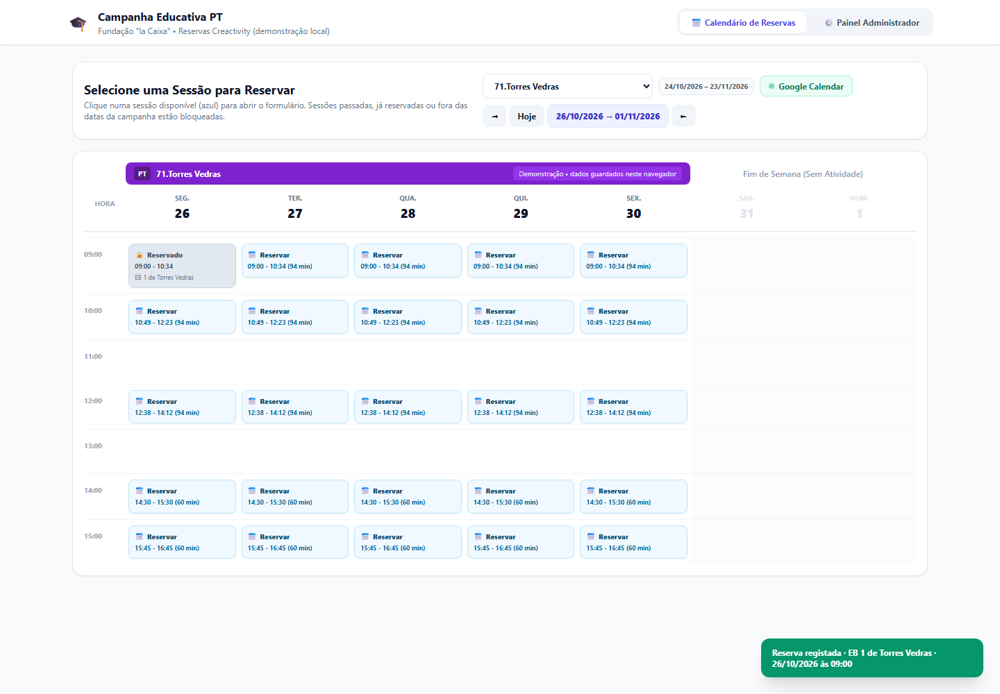

# Agenda de Reservas — Campanha Educativa PT

Aplicação web de página única (sem build e sem instalação) para gerir as reservas dos ateliers
**Creactivity** da Fundação "la Caixa": calendário semanal por campanha, formulário de reserva para
grupos escolares e painel de administração com horários, durações, localidades e exportação de reservas.

**Online:** <https://centauropt.github.io/agenda-de-reservas/>



## Funcionalidades

**Vista pública**
- **Banner da campanha** por cima dos dias que pertencem ao intervalo da localidade (2 dias, 3 dias, …);
  os dias fora do intervalo **não têm banner**.
- **Calendário semanal estilo Google Calendar**: eventos posicionados pela hora e pela duração, com
  sobreposições lado a lado, noite/dia por coluna e indicador do dia atual.
- No painel de administração o calendário é editável: arrastar o bloco muda hora/dia, arrastar a base
  redimensiona, duplo clique no vazio cria e duplo clique no bloco apaga.
- Sessões coloridas por estado: disponível, reservada, passada e fora do período da campanha.
- **Sessões passadas** ficam esbatidas (opacidade 50%), com contorno tracejado e a indicação
  "⏳ Sessão passada"; não abrem o formulário nem podem ser reservadas.
- Navegação por semanas, botão "Hoje" e salto automático para a semana da campanha ao mudar de localidade.
- Aviso de sessões sobrepostas e de sessões que terminam no dia seguinte.
- Formulário de reserva com validação de nome, escola, e-mail, telemóvel português (9 dígitos),
  número de alunos (1–25), ano frequentado e programa da Fundação "la Caixa".

**Painel de administração**
- **Horário semanal por dia da semana** (segunda a sexta): cada dia tem os seus horários com início e
  fim editáveis, exatamente como no Google Calendar.
- **Ajustes por data**: cada dia pode ter os seus próprios horários (09:00–10:15, 10:15–11:30, …), com
  adicionar/remover por dia; o calendário mostra exatamente o que está definido em cada data.
- **Copiar horário** de um dia para todos os dias úteis de um intervalo.
- **Fins de semana sob exceção**: o botão "Ativar sábado e domingo desta semana" cria sessões nesses
  dias (ou basta adicionar um ajuste na data); enquanto não estiverem ativos ficam esbatidos.
- Campanhas (localidades) com data de início e de fim; o calendário bloqueia datas fora do intervalo.
- Reservas registadas: listagem, contagem de alunos, cancelamento individual e **exportação CSV**
  (separador `;` e BOM, pronta para Excel).
- **Janelas arrastáveis e redimensionáveis** no painel: arrastar pela barra de título, redimensionar pelo
  canto inferior direito; a disposição fica guardada e há o botão **Repor janelas**.
- Reinício dos dados locais.

## Como usar

Basta abrir `index.html` no navegador. Para servir por HTTP (recomendado para testar em telemóvel):

```bash
python -m http.server 8000
# http://localhost:8000
```

Não há dependências para instalar. O único recurso externo é o Tailwind CSS via CDN
(`cdn.tailwindcss.com`), pelo que é necessária ligação à internet na primeira carga.

### Ver as alterações em direto

Servidor de pré-visualização com **auto-reload** (recarrega a página aberta sempre que `index.html`
é gravado):

```bash
python tools/preview.py          # http://127.0.0.1:8080
```

Sem terminal: duplo clique em `tools\abrir-preview.cmd` — arranca o servidor se for preciso e abre o
browser já no endereço certo.

Expõe apenas `index.html` e `docs/`; o resto do repositório (`.git`, README, etc.) devolve 404.

### Publicar no GitHub Pages (ativo — sem build, sem custos)

O repositório está pronto: `index.html` na raiz e `.nojekyll` a impedir o processamento Jekyll.
**A aplicação já está publicada em:**

**https://centauropt.github.io/agenda-de-reservas/**

Para replicar noutra conta ou fork:

1. No GitHub, abrir **Settings → Pages**.
2. Em **Source**, escolher `Deploy from a branch`.
3. **Branch:** `main` · **Folder:** `/ (root)` → **Save**.

Cada push para `main` republica automaticamente (pode levar até 1 minuto a propagar).

### Publicar no Vercel (alternativa)

O projeto é um site estático puro (sem build, sem dependências), por isso o deploy é direto:

1. Em [vercel.com/new](https://vercel.com/new), importar o repositório `CentauroPt/agenda-de-reservas`.
2. Configuração do projeto:
   - **Framework Preset:** `Other`
   - **Build Command:** vazio
   - **Output Directory:** vazio (raiz)
   - **Install Command:** vazio
3. Deploy. O `index.html` da raiz passa a ser servido em `https://<projeto>.vercel.app`.

O ficheiro `vercel.json` já define `cleanUrls`, `trailingSlash: false` e cabeçalhos de segurança
(`X-Content-Type-Options`, `Referrer-Policy`, `X-Frame-Options`), além de cache de 1 dia para as
imagens em `docs/`. Não são necessárias variáveis de ambiente.

Alternativa por linha de comandos (depois de `vercel login`):

```bash
npx vercel --prod
```

Cada `git push` para `main` gera automaticamente um novo deployment; os restantes branches e pull
requests geram *preview deployments*.

> Nota: em produção os dados das reservas continuam no `localStorage` de cada visitante. No domínio
> Vercel isso é aceitável para demonstração, mas para uso real é preciso backend (ver limitações).

## Estrutura

```
index.html   # aplicação completa (HTML + CSS + JavaScript)
vercel.json  # configuração de deploy estático no Vercel
.nojekyll    # diz ao GitHub Pages para servir os ficheiros tal como estão
docs/        # capturas de ecrã usadas na documentação
```

## Dados e persistência

Os dados ficam no navegador, em `localStorage`, sob a chave `campanha_pt_v3`:

```json
{
  "locations": [
    { "id": "loc-...", "name": "71.Torres Vedras", "startDate": "2026-10-26", "endDate": "2026-11-23" }
  ],
  "selectedLocation": 0,
  "weeklySlots": {
    "1": [{ "start": "09:00", "end": "10:15" }, { "start": "10:15", "end": "11:30" }],
    "2": [{ "start": "09:00", "end": "10:15" }],
    "3": [],
    "4": [{ "start": "09:00", "end": "10:15" }],
    "5": [{ "start": "09:00", "end": "10:15" }]
  },
  "dateSlots": {
    "2026-10-28": [
      { "start": "08:00", "end": "08:45" },
      { "start": "10:00", "end": "11:30" }
    ]
  },
  "bookings": {
    "loc-...|2026-10-27|09:00": {
      "locationId": "loc-...",
      "date": "2026-10-27",
      "sessionStart": "09:00",
      "sessionEnd": "10:34",
      "duration": 94,
      "schoolName": "EB 1 de Torres Vedras",
      "students": 22,
      "firstName": "Marta",
      "lastName": "Ferreira",
      "email": "marta.ferreira@eb1-torres.pt",
      "phone": "919876543",
      "companionName": "João Ferreira",
      "companionPhone": "917654321",
      "grade": "3º Ano",
      "laCaixa": "Sim",
      "laCaixaDetails": "Programa EduCaixa",
      "createdAt": "2026-10-24T16:10:00.000Z"
    }
  }
}
```

O horário antigo (manhã/tarde + duração) é convertido automaticamente no horário por dia da semana.

As chaves de reserva passaram a usar o `id` da campanha (e não o nome), para que renomear uma
localidade não perca reservas. Dados de versões anteriores, guardados por nome, são migrados
automaticamente na primeira abertura.

## Privacidade e acesso

- Na vista pública, as sessões reservadas aparecem **esbatidas e apenas com “🔒 Reservado”** — nunca
  mostram a escola, os alunos ou os contactos de quem reservou; clicar apenas avisa que está reservada.
- O **Painel de Administração exige um PIN**. Na primeira abertura é pedido para definir um (mínimo 4
  dígitos); depois é pedido em cada sessão, com o botão **Bloquear** para sair.
- O PIN é guardado como *hash* no `localStorage`, não em texto. **Atenção:** num site estático isto é
  uma barreira de acesso, não autenticação verdadeira — quem dominar o browser pode contorná-la. Para
  segurança real é necessário backend com contas de utilizador (ver limitações).
- “Esqueci o PIN” permite recomeçar, mas **apaga os dados deste navegador** (reservas, campanhas,
  configurações).

## Email de confirmação

Na sub-página **Google Calendar** existe o bloco **✉️ Email de confirmação**. Quando está ativo, cada
reserva enviada pelo formulário dispara um email para o endereço indicado pelo utilizador, com:

- localidade (campanha) e **localização/morada** (novo campo em cada campanha do painel);
- escola, nº de alunos e ano;
- data, hora de início/fim e duração;
- nome e telefone do responsável e do acompanhante;
- programa da Fundação “la Caixa”.

O envio usa o **EmailJS** (emailjs.com), que permite enviar a partir do email da campanha sem servidor.
No painel configuram-se: **Service ID**, **Template ID**, **Public Key**, nome do remetente, email de
resposta e assunto. O template do EmailJS deve usar as variáveis `to_email`, `to_name`, `from_name`,
`reply_to`, `subject`, `message` (e pode usar também `locality`, `address`, `school`, `students`,
`grade`, `date`, `start`, `end`, `duration`, `companion`, `companion_phone`, `phone`, `la_caixa`,
`booking_ref`).

Há um botão **Enviar teste** para validar a configuração. Nota: o EmailJS tem limites no plano gratuito
(ex.: 200 emails/mês) e o remetente efetivo é o serviço de email ligado à conta.

## Identidade

Na sub-página **Google Calendar** existe o bloco **🪪 Identidade**, que permite alterar:

- **ícone** (emoji) **ou imagem/logo** carregada do computador (PNG, JPG, WebP ou SVG até 400 KB),
  guardada no `localStorage` como `data:` URL;
- **título** e **subtítulo** do cabeçalho;
- **título e subtítulo do painel** de administração;
- **título do calendário público** (“Escolha a sessão…”);
- **etiquetas dos separadores** (Calendário / Gestão);
- **fonte do cabeçalho** (70 opções) e **três tamanhos**: título (10–40 px), título do painel
  (14–48 px) e subtítulos (8–28 px).

Tudo com pré-visualização, botão **Aplicar** e **Repor identidade**.

## Aparência

Na sub-página **Google Calendar** existe o bloco **🎨 Aparência**, que permite personalizar
**cada banner** separadamente:

- **texto do banner**, com etiquetas dinâmicas: `{localidade}`, `{dias}`, `{inicio}`, `{fim}`
  (ex.: `Reservas Creactivity — {localidade} ({dias})`);
- **cor** (10 tons predefinidos ou seletor livre; o texto ajusta automaticamente entre claro/escuro);
- **fonte** (33 opções, incluindo 12 Google Fonts carregadas só quando escolhidas);
- **tamanho** de 8 a 24 px no banner.

Há ainda a **tipografia da aplicação** (fonte e tamanho de 10 a 26 px) para os restantes textos.
Tudo fica guardado no `localStorage`, com pré-visualização ao vivo e **Repor aparência**.

## Ligação ao Google Calendar (opcional)

No painel de administração existe a sub-página **Google Calendar**, com os campos necessários:

| Campo | Onde obter |
|---|---|
| **Client ID** | Google Cloud → Credentials → OAuth client ID (Web application) |
| **Calendar ID** | `primary` para o calendário principal, ou o ID de outro calendário |
| **API Key** | Opcional; só para leituras públicas |

Antes de ligar, no Google Cloud: ativar a Calendar API, configurar o *OAuth consent screen* (External +
o teu email em *Test users*) e adicionar às **Authorized JavaScript origins** e **Authorized redirect
URIs** o endereço mostrado na própria página (ex.: `https://centauropt.github.io`).

Depois de autorizar, a página permite **testar a ligação** e **exportar as reservas** para o calendário
como eventos (título, descrição, local, hora de início e fim em `Europe/Lisbon`). O token de acesso
fica apenas na memória do separador e expira ao fim de ~1 hora.

## Limitações conhecidas

- **Sem backend:** cada navegador tem os seus próprios dados. Não há sincronização entre dispositivos
  nem reservas concorrentes de várias pessoas — para uso real em produção é necessário servidor e base
  de dados.
- **Sem integração real com o Google Calendar:** o botão "Simular Alteração Google Calendar" apenas
  demonstra o comportamento; não existe chamada à API.
- Tailwind CSS é carregado por CDN, pelo que sem internet a página fica sem estilos.

## Próximos passos sugeridos

1. API + base de dados (reservas, campanhas, horários) com autenticação para o painel de administração.
2. Sincronização bidirecional com Google Calendar (OAuth na conta da organização).
3. Notificações por e-mail ao responsável do grupo e à organização.
4. Relatórios de ocupação por campanha e exportação para Excel.

## Fluxo de trabalho

Cada tarefa termina com commit e push para `main`, pelo que o deploy no Vercel acompanha
automaticamente. O atalho valida a sintaxe do JavaScript de `index.html` antes de publicar:

```powershell
# Windows PowerShell (incluído no Windows), a partir da raiz do repositório
powershell -NoProfile -ExecutionPolicy Bypass -File tools/sync.ps1 -Message "Corrige validação do formulário"
```

As regras completas estão em [AGENTS.md](AGENTS.md).
